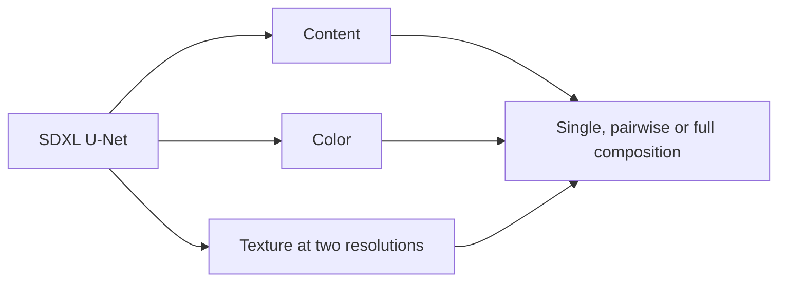

<div align="center">

# HO-LoRA

### Composable content, color and texture adaptation for SDXL

**Hierarchical Orthogonal LoRA — core training, evaluation, and visual results.**

[English](README.md) · [简体中文](README.zh-CN.md) · [Core implementation](docs/CORE.md) · [Method](docs/METHOD.md) · [Results](results/README.md) · [Evaluation](docs/EVALUATION.md)

**SDXL · Three adapter branches · Four-step training cycle**

[](https://github.com/KKbiubiu/HO-LoRA/actions/workflows/checks.yml)

</div>

[](results/README.md)

[Results](results/README.md)

## Overview

HO-LoRA explores fine-grained style control by assigning SDXL U-Net adapters to three composable branches: **Content**, **Color** and **Texture**. The v12 design combines Texture adapters at two feature resolutions with a four-step training cycle, including a step that trains Texture alone.

This repository provides the core training and evaluation implementation, twelve original-resolution results, and recorded evaluation data. The training code isolates branch allocation, the four-phase optimization cycle and cross-Gram regularization. Data loading, model downloads, checkpoint management and the complete generation workflow remain outside this focused release. See [release scope](docs/RELEASE_SCOPE.md).

## What is included?

| Component | Availability |
| :--- | :--- |
| Method and evaluation documentation | Included |
| Results | Twelve unchanged 1024 × 1024 PNG images |
| Training core | Branch-specific LoRA, four phases and orthogonal regularization |
| Evaluation core | Color Histogram Distance, Edge IoU, VGG19 Gram Distance and ΔT |
| Six recorded evaluation JSON files | Included without numerical changes |
| Evaluation prompts and recorded v12 settings | Included |
| Summary generator and verification tests | Runnable with Python 3.10+; standard library only |
| Training images and model weights | Not distributed |

## How it works



| Branch | U-Net attention blocks | Recorded rank |
| :--- | :--- | ---: |
| Content | `up_blocks.0.attentions.0` | 64 |
| Color | `up_blocks.0.attentions.1` | 32 |
| Texture | `up_blocks.0.attentions.2`, `up_blocks.1.attentions.{0,1,2}` | 128 |

The training cycle alternates between joint reconstruction with an orthogonal term, color jitter with Color disabled, blur plus noise with Texture disabled, and Texture-only reconstruction. Branch names describe their intended roles; they do not guarantee independent control of every visual attribute.

See the [method notes](docs/METHOD.md) for the cycle, composition variants and a historical coefficient discrepancy that affects interpretation of the saved configuration.

## Core implementation

The implementation consists of two modules:

- [`core/training.py`](core/training.py): SDXL attention placement, LoRA composition, phase-specific augmentation and gradient routing, and a single optimization step.
- [`core/evaluation.py`](core/evaluation.py): image metrics, paired comparisons against each prompt's full output, and texture ΔT.

Use **Python 3.10 or 3.11**. From the repository root, create a clean environment and install the core dependencies. The following CPU setup is sufficient for the tests:

```bash
python3 -m venv .venv
source .venv/bin/activate
python -m pip install torch==2.1.0 torchvision==0.16.0 --index-url https://download.pytorch.org/whl/cpu
python -m pip install -r requirements-core.txt
python -m unittest discover -s tests -p 'test_*_core.py' -v
```

On Windows, use `py -3.11 -m venv .venv` and activate it with `.venv\Scripts\Activate.ps1` in PowerShell. For GPU integration, install a matching CUDA build of PyTorch and Torchvision instead of the CPU wheels.

The tests run without SDXL or VGG downloads. Actual training receives the caller's U-Net, VAE, noise scheduler and prepared SDXL conditioning. VGG evaluation explicitly loads official pretrained weights and fails if they are unavailable. See [API examples and integration requirements](docs/CORE.md).

## Recorded results

The recorded experiments use 50 Egon Schiele training images and 15 evaluation prompts.

| Configuration | Texture GramDist ↓ | ΔT ↑ |
| :--- | ---: | ---: |
| HO-LoRA v10 | 4.049 | −0.018 |
| Without Texture-Solo | 4.078 | −0.051 |
| Without orthogonal loss | 3.229 | +1.091 |
| **HO-LoRA v12** | **2.988** | **+1.111** |

`ΔT = GramDist(no_lora, full) − GramDist(texture_only, full)`.

Each experiment uses **its own full-adapter output** as the reference. A positive ΔT means that Texture-only is closer to that reference than the base model under this feature metric. It is not a general image-quality score.

Removing Texture-Solo changes the recorded ΔT by **1.162**; removing orthogonal loss changes it by **0.020**. These are descriptive differences, not causal contribution percentages or evidence of statistical significance. The [complete table](results/SUMMARY.md) includes the local Standard LoRA and B-LoRA baselines; [raw JSON](results/raw) and [provenance](results/provenance.json) support the calculations.

## Run the summary tools

### 1. Get the project

Clone the repository and enter its root directory:

```bash
git clone https://github.com/KKbiubiu/HO-LoRA.git
cd HO-LoRA
```

Install **Python 3.10 or newer** and check the interpreter:

```bash
python3 --version
```

On Windows, use `py -3` in place of `python3`. The summary tools use only Python's standard library: no package installation, GPU or model download is required.

### 2. Verify the supplied results

```bash
python3 tools/summarize_results.py --check
python3 -m unittest discover -s tests -p test_results.py -v
```

The first command checks that the committed CSV and Markdown tables match the six raw JSON files. It prints `Result summaries verified.` on success. The tests check the recorded differences, reject invalid metrics and verify table consistency.

### 3. Regenerate the tables

```bash
python3 tools/summarize_results.py
```

This rewrites `results/summary.csv` and `results/SUMMARY.md` from `results/raw/eval_*.json`. Open [the generated table](results/SUMMARY.md) to inspect the output, then rerun the verification commands above.

These steps reproduce the **summary calculations**. They do not run model training, generate images or recompute image metrics. The input JSON files remain unchanged.

## Repository layout

```text
assets/                  Result preview, branch comparison and provenance
core/training.py         Branch adapters and the four-phase optimization step
core/evaluation.py       Paired image metrics and texture ΔT
docs/                    Core API, method, evaluation and release scope
results/images/          Original-resolution results
results/README.md        Results gallery
results/raw/             Six recorded evaluation JSON files
results/summary.csv      Machine-readable comparison
results/SUMMARY.md       Generated comparison table
results/prompts.json     Evaluation prompts and inference defaults
results/v12_configuration.json
                         Recorded v12 configuration
tools/                   Summary regeneration utility
tests/                   Core behavior and result consistency tests
```

## Limitations

The evidence covers one artist, one SDXL backbone and manually selected attention blocks. Independent training repeats, human evaluation and generalization to other artists are not established by these records. CLIP-I values are absent, VGG weight provenance is incomplete, and the exact historical model revision and complete environment were not recorded. Read the [evaluation protocol](docs/EVALUATION.md) before comparing results or using the tables to support stronger claims.

## Related projects and contributions

This project builds on [LoRA](https://github.com/microsoft/LoRA), [SDXL](https://huggingface.co/stabilityai/stable-diffusion-xl-base-1.0), [Diffusers](https://github.com/huggingface/diffusers) and [B-LoRA](https://github.com/yardenfren1996/B-LoRA). B-LoRA results in this repository come from a local baseline implementation.

Core implementation improvements and documentation or result corrections are welcome through repository issues or pull requests. See [contribution guidance](CONTRIBUTING.md). No license has been selected for this repository; see [license status](LICENSE_STATUS.md).
