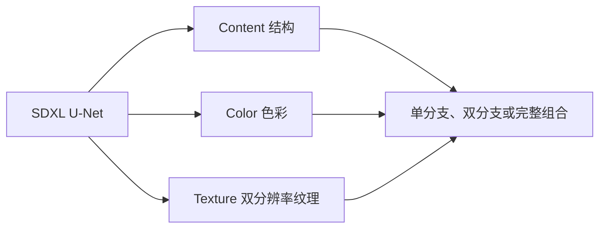

<div align="center">

# HO-LoRA

### 面向 SDXL 的结构、色彩与纹理组合适配

**Hierarchical Orthogonal LoRA · 核心训练、评估实现与结果展示。**

[English](README.md) · [简体中文](README.zh-CN.md) · [核心实现](docs/CORE.md) · [方法说明](docs/METHOD.md) · [结果](results/README.md) · [评估协议](docs/EVALUATION.md)

**SDXL · 三个适配分支 · 四步训练周期**

[](https://github.com/KKbiubiu/HO-LoRA/actions/workflows/checks.yml)

</div>

[](results/README.md)

[结果](results/README.md)

## 项目介绍

HO-LoRA 将 SDXL U-Net 中的 LoRA 适配器划分为 **Content（结构）**、**Color（色彩）**、**Texture（纹理）** 三个可组合分支。v12 采用双分辨率纹理分支和四步训练周期，加入仅训练 Texture 的独立步骤，探索更细粒度的风格控制。

本仓库提供核心训练与评估实现、12 张原始分辨率结果以及已记录的评估数据。训练代码集中展示分支划分、四阶段优化和 cross-Gram 正交约束。数据加载、模型下载、检查点管理和完整生成流程不属于本次精简发布范围。详见[公开范围](docs/RELEASE_SCOPE.md)。

## 仓库内容

| 内容 | 状态 |
| :--- | :--- |
| 方法与评估说明 | 已提供 |
| 结果 | 12 张未经修改的 1024 × 1024 PNG 原图 |
| 核心训练 | 分支 LoRA、四阶段训练与正交约束 |
| 核心评估 | 颜色直方图距离、边缘 IoU、VGG19 Gram 距离及 ΔT |
| 六组原始评估 JSON | 已提供，保留原始数值 |
| 评估提示词与 v12 参数记录 | 已提供 |
| 汇总脚本与验证测试 | 可运行，Python 3.10+ 标准库 |
| 原始训练图像与模型权重 | 不分发 |

## 核心设计



| 分支 | SDXL U-Net 插入位置 | 记录的 Rank |
| :--- | :--- | ---: |
| Content | `up_blocks.0.attentions.0` | 64 |
| Color | `up_blocks.0.attentions.1` | 32 |
| Texture | `up_blocks.0.attentions.2` 和 `up_blocks.1.attentions.{0,1,2}` | 128 |

四步训练周期依次为：原图联合训练并加入正交项；色彩抖动并禁用 Color；模糊加噪并禁用 Texture；原图仅训练 Texture。分支名称表示预期作用，不代表所有视觉属性已经实现完全独立控制。

训练周期、分支组合及历史配置中需要注意的系数差异见[方法文档](docs/METHOD.md)。

## 核心实现

实现集中在两个模块：

- [`core/training.py`](core/training.py)：SDXL 注意力层位置、LoRA 组合、分阶段增强与梯度分配，以及单步参数优化。
- [`core/evaluation.py`](core/evaluation.py)：图像指标、同一提示词下以 full 输出为参照的配对评估，以及纹理 ΔT。

使用 **Python 3.10 或 3.11**。在仓库根目录创建独立环境并安装核心依赖。以下 CPU 配置即可运行测试：

```bash
python3 -m venv .venv
source .venv/bin/activate
python -m pip install torch==2.1.0 torchvision==0.16.0 --index-url https://download.pytorch.org/whl/cpu
python -m pip install -r requirements-core.txt
python -m unittest discover -s tests -p 'test_*_core.py' -v
```

Windows 使用 `py -3.11 -m venv .venv`，并在 PowerShell 中执行 `.venv\Scripts\Activate.ps1` 激活环境。集成 GPU 训练时，应将 CPU 版 PyTorch、Torchvision 替换为匹配的 CUDA 版本。

测试不需要下载 SDXL 或 VGG。实际训练由调用方提供 U-Net、VAE、噪声调度器及 SDXL 条件输入；VGG 评估显式加载官方预训练权重，加载失败时终止。接口示例与集成要求见[核心代码说明](docs/CORE.md)。

## 已记录的结果

当前实验使用 50 幅 Egon Schiele 训练图像和 15 个评估提示词。

| 配置 | Texture GramDist ↓ | ΔT ↑ |
| :--- | ---: | ---: |
| HO-LoRA v10 | 4.049 | −0.018 |
| 去除 Texture-Solo | 4.078 | −0.051 |
| 去除正交损失 | 3.229 | +1.091 |
| **HO-LoRA v12** | **2.988** | **+1.111** |

`ΔT = GramDist(no_lora, full) − GramDist(texture_only, full)`。

每个实验都以**自身的 full 输出**作为参照。ΔT 为正表示 Texture-only 在该特征指标下比基础模型更接近这个参照，并非通用图像质量分数。

记录中，去除 Texture-Solo 和去除正交项对应的 ΔT 差值分别为 **1.162** 和 **0.020**。这些差值用于描述当前设置中的现象，不能换算成因果贡献百分比，也没有建立统计显著性。[完整结果表](results/SUMMARY.md)包含本地 Standard LoRA 和 B-LoRA 基线；计算依据见[原始 JSON](results/raw)与[来源记录](results/provenance.json)。

## 安装与运行汇总工具

### 1. 获取项目并准备 Python

克隆仓库并进入根目录：

```bash
git clone https://github.com/KKbiubiu/HO-LoRA.git
cd HO-LoRA
```

安装 **Python 3.10 或更新版本**，确认解释器可用：

```bash
python3 --version
```

Windows 可将下面命令中的 `python3` 替换为 `py -3`。仅运行汇总工具时只需 Python 标准库，无需安装额外依赖、配置 GPU 或下载模型。

### 2. 核验现有结果

```bash
python3 tools/summarize_results.py --check
python3 -m unittest discover -s tests -p test_results.py -v
```

第一条命令核对 CSV、Markdown 汇总是否与六份原始 JSON 一致，成功后显示 `Result summaries verified.`。测试检查结果差值、无效指标处理及汇总表一致性。

### 3. 重新生成汇总表

```bash
python3 tools/summarize_results.py
```

脚本从 `results/raw/eval_*.json` 读取记录，重新写入 `results/summary.csv` 与 `results/SUMMARY.md`。打开[生成的结果表](results/SUMMARY.md)查看内容，再执行上一步的核验命令。

这些步骤复现的是**汇总计算**，不会训练模型、生成图像或重新计算图像指标，也不会修改原始 JSON。

## 目录结构

```text
assets/                  结果预览、分支对比图与来源记录
core/training.py         分支适配器与四阶段优化步骤
core/evaluation.py       配对图像评估及纹理 ΔT
docs/                    核心接口、方法、评估与公开范围
results/images/          原始分辨率结果图
results/README.md        结果图集
results/raw/             六份原始评估 JSON
results/summary.csv      可读取和分析的 CSV 汇总
results/SUMMARY.md       自动生成的结果表
results/prompts.json     评估提示词与推理默认参数
results/v12_configuration.json
                         v12 参数记录
tools/                   汇总工具
tests/                   核心行为与结果一致性测试
```

## 已知局限

当前证据限于一个艺术家、一个 SDXL 骨干及人工选择的注意力模块，尚未建立独立训练重复、人工评价或跨艺术家的充分验证。所选记录没有 CLIP-I 数值，VGG 权重来源不完整，完整历史环境与精确模型 revision 也未保存。比较数值或解读效果前，请阅读[评估协议](docs/EVALUATION.md)。

## 相关项目与参与方式

项目基于 [LoRA](https://github.com/microsoft/LoRA)、[SDXL](https://huggingface.co/stabilityai/stable-diffusion-xl-base-1.0)、[Diffusers](https://github.com/huggingface/diffusers) 与 [B-LoRA](https://github.com/yardenfren1996/B-LoRA) 相关工作。仓库中的 B-LoRA 数值来自本地基线实现。

欢迎通过 Issues 或 Pull Requests 改进核心实现或反馈文档与结果问题，具体流程见[贡献说明](CONTRIBUTING.md)。本仓库尚未选择许可证，详见[许可证状态](LICENSE_STATUS.md)。
