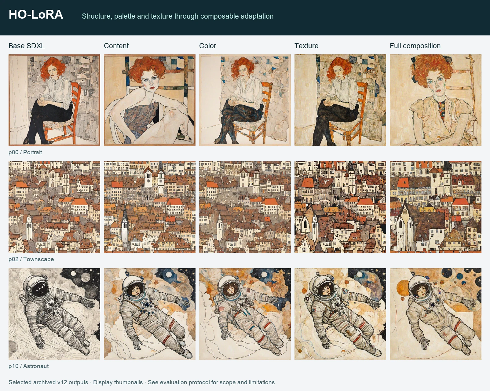

# Method

HO-LoRA assigns SDXL U-Net adapters to Content, Color and Texture branches. The branch names describe intended functions; independent semantic control is not established by the recorded experiments.

## Branch allocation

| Branch | Attention prefix | Rank | Recorded learning rate |
| :--- | :--- | ---: | ---: |
| Content | `up_blocks.0.attentions.0` | 64 | 1e-4 |
| Color | `up_blocks.0.attentions.1` | 32 | 5e-5 |
| Texture | `up_blocks.0.attentions.2` and `up_blocks.1.attentions.0/1/2` | 128 | 1.5e-4 |

Adapters attach to the attention query, key, value and output projections. Texture spans the 32×32 and 64×64 feature resolutions for 1024×1024 generation. The recorded configuration contains 59,342,848 trainable adapter parameters.

## Four-step training cycle

| Step | Input | Active branches | Orthogonal term |
| :--- | :--- | :--- | :--- |
| 4k | Original image | Content + Color + Texture | Enabled |
| 4k+1 | Color jitter | Content + Texture | Disabled |
| 4k+2 | Blur plus noise | Content + Color | Disabled |
| 4k+3 | Original image | Texture only | Disabled |

Color jitter and blur-plus-noise transformations are applied during training. The Texture-only step gives the Texture adapters a reconstruction update without the other two branches being active.

The saved run records 2,000 training steps, batch size 1, resolution 1024, seed 42, cosine learning-rate scheduling, Min-SNR weighting and noise offset. These are historical settings, not a complete reproducible environment specification. See [the recorded configuration](../results/v12_configuration.json).

## Orthogonal regularization

The loss uses the mean squared cross-Gram similarity of normalized LoRA down-projection rows for selected branch pairs. The historical v12 implementation applies Content–Color and Content–Texture terms; it has no separate Color–Texture term.

The saved `ortho_ct_weight` is **0.3**, while the retained historical training source uses a fixed Content–Texture coefficient of **0.5** without reading that argument. The executed source was not versioned with the run, so the actual coefficient cannot be certified from the saved configuration. The released results retain their original values and this uncertainty.

The public [training core](../core/training.py) makes this coefficient explicit as `ct_weight`, defaulting to **0.5**. It matches projection paths in the same-width Content, Color and first Texture blocks. Texture's three higher-resolution blocks contribute reconstruction gradients but are not included in this cross-Gram pairing. The public API is described in [CORE.md](CORE.md).

## Branch composition

The recorded inference setup evaluates eight variants:

| Variant | Active adapters |
| :--- | :--- |
| `no_lora` | None; base SDXL |
| `full` | Content + Color + Texture |
| `content_only` | Content |
| `color_only` | Color |
| `texture_only` | Texture |
| `content_color` | Content + Color |
| `content_texture` | Content + Texture |
| `color_texture` | Color + Texture |

Each recorded experiment covers 15 prompts. The public comparison figure shows selected outputs from five variants; it does not replace the full quantitative evaluation.

[Project overview](../README.md) · [Evaluation protocol](EVALUATION.md)
